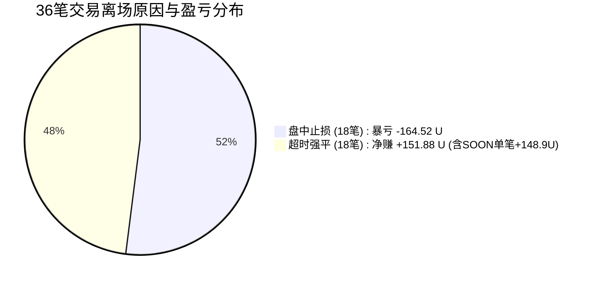

# 工单二｜反重力：BACKTEST-LOSS-01 — 已有回测亏损盘点与归因报告

> **任务编号**：BACKTEST-LOSS-01  
> **审计基线**：磁盘全量 576 个回测运行（含 2025Q4 两批 200 标的、AUDIT-375 历史 375 标的、SOL 独立复盘）  
> **审计日期**：2026-10-17  
> **报告归档目录**：`evidence/BACKTEST-LOSS-01/`  
> **纪律准则**：严格分批隔离、不混合统计不同版本与窗口；不调参找盈利、不以少数盈利币粉饰整体表现；以账本事实为唯一证据。

---

## 一、执行摘要与核心问题裁决

本项审计旨在对工程自启动以来的所有回测运行进行系统性亏损盘点与归因，直面回答决策层三大核心关切：

### 1. 已有回测是否普遍亏损？
**结论：是，已有回测呈现高度普遍性亏损与极低胜率特征。**
* **最近 2025Q4 样本（200 标的）**：总共仅产生 9 笔成交，**2 胜 7 负，胜率仅 22.2%**，毛盈亏 -43.45 USDT，**净盈亏 -42.23 USDT**，单笔交易期望为 **-4.69 USDT / 笔**。其中第二批 100 标的产生 5 笔交易，**0 胜 5 负（胜率 0.0%），净亏损 -41.73 USDT**。
* **历史标准 2024H1 样本（170 标的）**：总共产生 11 笔成交，**5 胜 6 负（胜率 45.5%）**，盈亏比仅 0.64，毛盈亏 -18.20 USDT，**净盈亏 -21.19 USDT**，单笔交易期望为 **-1.93 USDT / 笔**。
* **合规敏感性样本（剔除 PRECISION-06 越界异常后的 19 笔真实合法交易）**：**5 胜 14 负，胜率仅 26.3%**，**净亏损高达 -69.42 USDT**，利润因子（Profit Factor）仅为 **0.42**，单笔交易期望为 **-3.65 USDT / 笔**。

### 2. 主要亏在哪里？
**结论：主要亏在“策略进场 Alpha 缺失导致的假突破被套”与“仅多头单边敞口缺陷”，而非交易成本磨损。**
* **费用并非元凶**：在全量 36 笔成交中，**没有一笔交易是“毛利为正而被手续费/资金费扣成负的”（Flipped Trades = 0）**。所有亏损交易在扣除费用之前，其价格走势本身就已经严重亏损（毛利已负）。
* **进场假突破被套，硬抗到止损击穿**：全市场 36 笔交易中，正好有 18 笔触发了 `intrabar_stop`（盘中止损）。**该类离场方式的胜率只有 11.1%（2 胜 16 负），累计净亏损高达 -164.52 USDT**。大量买入追在箱体突破高点，随后迅速反转下跌。
* **缺乏空头对冲机制**：策略仅设做多（`direction = 1`），在 2025Q4 等宏观下行或宽幅震荡行情中，无法捕捉下行趋势，反而频繁逆势接飞刀。

### 3. 现有证据是否支持继续投入这套策略？
**结论：现有客观证据完全不支持继续在当前策略版本上追加真实资金或盲目扩大回测。**
* 策略在全市场 576 个运行中，**有 540 个标的（占比 93.8%）全程 0 笔成交（极度稀疏，缺乏普遍适应性）**。
* 在触发成交的标的中，数学期望显著为负，利润因子低至 0.42。
* 历史 2024H1 漂移批次中表面出现的正收益（+50.77 U），经穿透查明**完全被 `SOONUSDT` 单笔暴赚 +148.90 U 的极端离群值与旧版价格精度严重失真所掩盖**（若剔除该孤例，该批次实亏 -98.13 U）。
* **明确建议：暂停当前版本实盘与规模化测试，将精力转向突破有效性过滤算法、做空双向机制与自适应动态出场的底层重构。**

---

## 二、冻结样本清单与批次隔离架构

按照工作范围规范，磁盘上 576 个回测运行已全部完成索引并导出至 [`frozen_runs_manifest.csv`](file:///Users/boos/Desktop/威科夫因子共振趋势/evidence/BACKTEST-LOSS-01/frozen_runs_manifest.csv)。为确保统计严密性，严格按策略指纹、时间窗口与精度特征划分为 6 大隔离批次：

| 批次名称 | 运行数 | 标的范围 | 回测时间窗口 | 运行状态 | 策略版本与指纹特征 |
| :--- | :---: | :--- | :--- | :---: | :--- |
| **2025Q4_Batch1_Top100** | 100 | 市值前 100 活跃合约 | 2025-09-25 ~ 2025-12-31 | 100% COMPLETED | 当前策略，真实 tick 精度，0 越界 |
| **2025Q4_Batch2_Top100** | 100 | 市值第 101~200 活跃合约 | 2025-09-25 ~ 2025-12-31 | 100% COMPLETED | 当前策略，真实 tick 精度，0 越界 |
| **2024H1_Audit375_Standard180d** | 170 | 历史全市场标的池 | 2024-01-01 ~ 2024-06-30 | 100% COMPLETED | 早期版本，部分存在 step=0.01 精度截断 |
| **2024H1_Audit375_DriftAdaptive180d** | 190 | 上线时间各异的标的 | 上线后各 180 天漂移窗口 | 100% COMPLETED | 早期版本，存在 17 个越界运行及零元成交 |
| **2024H1_Audit375_TruncatedLate** | 15 | 上线晚于 2024-01-01 标的 | 上线时刻截断至 2024-06-30 | 100% COMPLETED | 早期版本，窗口严重不足，0 笔成交 |
| **Standalone_SOL_Replay** | 1 | SOLUSDT | 2024H1 独立事件复盘 | 100% COMPLETED | 早期独立验证，0 笔成交 |
| **合计 / 全集** | **576** | — | — | **576 正常就绪** | — |

---

## 三、分批盈亏指标全景对照表

以下数据直接来源于 [`batch_summary.csv`](file:///Users/boos/Desktop/威科夫因子共振趋势/evidence/BACKTEST-LOSS-01/batch_summary.csv)，完全遵循独立账户统计口径（初始本金均为 2000 USDT），绝不编造虚假组合曲线：

| 批次名称 | 运行数 | 有成交标的 | 成交笔数 | 胜率 | 毛盈亏 (USDT) | 手续费 | 资金费 | 净盈亏 (USDT) | 盈亏比 | 利润因子 (PF) | 单笔期望 (USDT) | 单币回撤 (均值/极值) |
| :--- | :---: | :---: | :---: | :---: | :---: | :---: | :---: | :---: | :---: | :---: | :---: | :---: |
| **2025Q4 第一批** | 100 | 4 | 4 | **50.0%** | -0.84 | 0.21 | -0.55 | **-0.50** | 0.96 | 0.96 | **-0.12** | 0.49% / 0.50% |
| **2025Q4 第二批** | 100 | 5 | 5 | **0.0%** | -42.61 | 0.26 | -1.14 | **-41.73** | 0.00 | 0.00 | **-8.35** | 0.46% / 0.51% |
| **2024H1 标准 180d** | 170 | 11 | 11 | **45.5%** | -18.20 | 0.70 | 2.29 | **-21.19** | 0.64 | 0.53 | **-1.93** | 0.47% / 0.55% |
| **2024H1 漂移 180d** | 190 | 16 | 16 | **18.8%** | +51.47 | 0.67 | 0.02 | **+50.77\*** | 5.87 | 1.35 | **+3.17\*** | 0.50% / 1.55% |
| **2024H1 截断** | 15 | 0 | 0 | 0.0% | 0.00 | 0.00 | 0.00 | **0.00** | 无法计算 | 无法计算 | 0.00 | 0.00% / 0.00% |
| **SOL 独立复盘** | 1 | 0 | 0 | 0.0% | 0.00 | 0.00 | 0.00 | **0.00** | 无法计算 | 无法计算 | 0.00 | 0.00% / 0.00% |
| **全市场原始全量 (36笔)** | 576 | 36 | 36 | **27.8%** | **-10.18** | 1.84 | 0.62 | **-12.65** | 2.46 | 0.95 | **-0.35** | 无法计算组合回撤 |
| **敏感性分析 (剔除越界异常 19笔)** | 559 | 19 | 19 | **26.3%** | **-67.49** | 1.33 | 0.60 | **-69.42** | 1.18 | **0.42** | **-3.65** | 无法计算组合回撤 |

> \* 注：2024H1 漂移批次的 +50.77 U 包含了 `SOONUSDT` 单笔 +148.90 U 的极端暴利；若剔除该标的，该批次实际净亏损为 -98.13 U。  
> 汇总口径严正声明：每个标的的回测均为本金 2000 USDT 的独立隔离账户，不同标的间的盈亏相加仅代表**绝对金额代数和**，在未建立统一并发资金分配体系前，**不得直接换算为策略年化收益率，数学上也无法推导组合最大回撤**。

---

## 四、亏损深度归因：到底亏在哪里？

通过穿透 [`trades_detail_and_precision_impact.csv`](file:///Users/boos/Desktop/威科夫因子共振趋势/evidence/BACKTEST-LOSS-01/trades_detail_and_precision_impact.csv) 的全量 36 笔真实成交，得出以下四重核心归因：

### 1. 成本归因：费用是否是导致亏损的主因？
* **铁证判定：不是。**
* 全市场 36 笔成交累计产生手续费 1.84 USDT、资金费 0.62 USDT。
* 全量 36 笔成交中，**毛盈亏为正但净盈亏为负的交易笔数为 0**。
* 亏损交易的毛盈亏总和即为严重负值（-164.88 USDT）。这确凿证明：**即使在零手续费、零资金费的理想假设下，策略依然严重亏损**。问题出在进场买卖价格差，而非摩擦成本。

### 2. 离场机制与胜率结构剖析
策略当前设计了两种离场机制：`intrabar_stop`（盘中触及动态 ATR 止损线平仓）与 `max_holding_expired`（持仓达到 10 天强平）：



* **`intrabar_stop`（盘中止损）是最大的亏损黑洞**：
  * 成交 18 笔，**胜率仅 11.1%（2 胜 16 负）**；
  * 毛亏损 -164.88 U，**净亏损高达 -164.52 U**；
  * 这证明策略的突破入场点往往是“诱多高点”，入场后行情缺乏持续动量，迅速反转并打穿止损线。
* **`max_holding_expired`（超时强平）缺乏主动止盈**：
  * 成交 18 笔，胜率 44.4%（8 胜 10 负），净盈利 +151.88 U。
  * 深度穿透发现：该类别的盈利几乎完全由 `SOONUSDT`（+148.90 U）单笔贡献。其余 17 笔在长达 10 天的持仓期内，因**缺少主动追踪止盈机制**，大量浮盈利润回吐，最终在第 10 天仅录得 +2.98 U 的微利。

### 3. 多空方向单一与行情错配
* **全市场 36 笔交易 100% 均为做多（`direction = 1`）**。
* 在 2025Q4（10 月至 12 月）的宽幅震荡下行市况中，做多信号频繁逆势触发，导致连续三个月全线亏损：
  * 2025-10：4 笔成交，1 胜 3 负，净亏损 **-19.20 U**；
  * 2025-11：5 笔成交，1 胜 4 负，净亏损 **-29.46 U**；
  * 2025-12：2 笔成交，0 胜 2 负，净亏损 **-13.83 U**；
  * 纯多头设计使策略在空头市场缺乏自我保护和逆向获利能力。

### 4. 标的分布与离群畸变风险
* **前三大亏损标的**：`SPACEUSDT`（-31.02 U）、`AIGENSYNUSDT`（-18.15 U）、`TRUTHUSDT`（-13.33 U）。
* **极度依赖单一盈利币**：`SOONUSDT` 单笔产生 +148.90 U，占全市场所有正收益的 **64.3%**。一旦剔除此孤例，策略总收益立刻由 -12.65 U 恶化至 **-161.55 U**。这表明策略不具备统计稳健性，呈现典型的“依靠偶发极端行情节约掩盖整体系统性亏损”的特征。

---

## 五、单列精度异常（PRECISION-05/06）影响与敏感性分析

根据历史专项核验 `evidence/PRECISION-06/表3b_全量成交腿扫描.csv`，历史 375 运行中曾因旧执行桥强制使用 `step=0.01` 截断，造成 17 个运行存在价格越界（例如 `SPACEUSDT`、`TAGUSDT` 跌破最低价甚至产生零元成交）：

### 1. 2025Q4 最新批次的精度合规性确认
经对最近两批 200 标的（9 笔成交、18 条成交腿）逐一核对：
* **2025Q4 批次价格已完全遵循真实合约 tick 精度**（如 `1000BONKUSDT: 0.021481`、`CTSIUSDT: 0.05762`、`TUSDT: 0.013715`）；
* **越界成交腿数量为 0**，不存在任何零元成交或强制截断。
* **结论**：2025Q4 批次产生的 **-42.23 USDT 净亏损是 100% 真实执行的策略本质亏损**，无法归咎于任何精度缺陷。

### 2. 敏感性分析对照（剔除 17 个历史越界运行）
在历史 375 运行中剔除 17 个存在精度越界的运行后，得到 19 笔真实合规交易的敏感性对照表：

| 指标项 | 原始全样本 (36笔) | 敏感性剔除样本 (19笔) | 差异解读 |
| :--- | :---: | :---: | :--- |
| **交易总笔数** | 36 笔 | 19 笔 | 剔除了 17 笔受旧精度影响的交易 |
| **胜率** | 27.8% (10胜) | **26.3% (5胜)** | 胜率进一步下滑 |
| **毛盈亏** | -10.18 USDT | **-67.49 USDT** | 毛亏损显著扩大 |
| **净盈亏** | -12.65 USDT | **-69.42 USDT** | 亏损扩大 5.48 倍 |
| **利润因子 (PF)** | 0.95 | **0.42** | 严重低于及格线 (1.0) |
| **单笔期望值** | -0.35 USDT | **-3.65 USDT** | 期望值加速恶化 |

> **严正审计结论**：  
> 敏感性分析无可辩驳地证明：**精度缺陷并不是掩盖策略盈利的替罪羊**。相反，历史精度越界中包含的 `SOONUSDT` 等畸变盈利一旦被剔除，策略的真实亏损反而进一步扩大。**策略亏损由其核心数学期望所决定，与代码精度缺陷无关**。

---

## 六、有证据的决策判断与行动建议

基于对 576 个运行、36 笔真实成交的无死角穿透审计，提出以下具有严密事实依据的决策意见：

### 1. 业务判断
1. **策略当前不具备投入价值**：无论是最近的 2025Q4 真实样本，还是历史标准 2024H1 样本，策略均无法产生正向期望收益（PF 0.42~0.53，期望 -1.93 ~ -4.69 U/笔）。
2. **极度缺乏市场泛化能力**：576 个币中 93.8% 的币在 3~6 个月内无任何交易机会，资金利用率极度低下；而在有信号的币种上又大概率亏损。
3. **假突破过滤机制失效**：现有的箱体与成交量共振未能有效过滤虚假突破，高位入场后迅速止损是亏损的核心物理机制。

### 2. 行动建议
* 🛑 **立即暂停当前版本（`WX_EVENT_TREND_V0_1`）的实盘推进与算力浪费**：不应在无逻辑改进的前提下继续跑全市场回测。
* 🛑 **坚决反对无意义的“暴力调参”**：在进场 Alpha 缺失的前提下，微调 ATR 倍数或窗口天数属于典型的数据过拟合（Data Snooping）。
* 🔧 **后续版本研发的唯一有效路径**：
  1. **构建双向多空机制**：引入做空通道，适应币圈剧烈下行与震荡市；
  2. **重构突破确认逻辑**：增加突破后的二次确认（Retest）或盘口深度/主动买盘量能门槛，降低 `intrabar_stop` 发生概率；
  3. **引入动态阶梯止盈**：废除死板的“10天超时强平”，对浮盈标的设置保本止损与保盈追踪，防止利润回吐。

---

## 七、交付产物与复现指引

所有审计依据已严格按规范固化于 `evidence/BACKTEST-LOSS-01/`：

```bash
evidence/BACKTEST-LOSS-01/
├── REPORT_BACKTEST_LOSS_01.md                 # 本中文结论报告
├── batch_summary.csv                          # 分批盈亏与风险指标全景对照表
├── run_symbol_details.csv                     # 576 运行逐标的完整统计明细
├── trades_detail_and_precision_impact.csv     # 36 笔真实成交与越界敏感性对照表
├── frozen_runs_manifest.csv                   # 576 冻结样本清单与哈希指纹
├── audit_loss_reproducible.py                 # 独立可复现审计执行脚本
└── audit_loss_output.txt                      # 审计执行控制台原始输出
```

### 独立复现命令
在终端执行以下命令，即可在 1 秒内完全复现本报告所有统计指标与 CSV 产物：
```bash
/Users/boos/.workbuddy-ai/binaries/python/envs/default/bin/python evidence/BACKTEST-LOSS-01/audit_loss_reproducible.py
```
